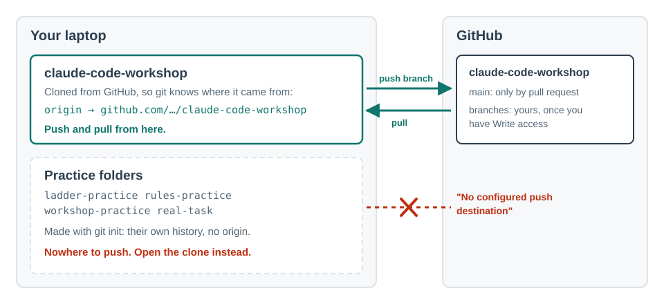

# Clone, branch, push

To work on something shared, you **clone** it (a full copy on your laptop, with its history), make
a **branch** (your own line of changes, so the main version is untouched), and **push** the branch
back to GitHub where others can see it. In a facilitated group you can push branches to this
repository, but not to its `main`: that only changes through a pull request the facilitator merges.

## Do

**Where:** a **+ New** session on the `claude-code-workshop` folder you cloned at the start, in
Manual. Not `ladder-manual`, `rules-practice` or `workshop-practice`: those were made with
`git init` and push, if at all, only to a folder on your laptop.

1. Check which folder you're in, and that it can reach GitHub.

   

   Send each line (the `!` runs it without Claude):
   - `!git remote -v`. **You should see:** a `github.com/…/claude-code-workshop` address. Nothing, or a path on your laptop? Wrong folder: **+ New**, choose `claude-code-workshop`.
   - `!git config user.email`. **You should see:** your email. Nothing? Ask Claude: *"Set my git name to <your name> and email to <the email on your GitHub account>, for every repository."*
   - `!gh auth status`. **You should see:** `Logged in to github.com account <you>`. Not found, or not logged in? Install GitHub CLI from cli.github.com, then in the terminal pane (**Ctrl** and the backtick key) type `gh auth login`, choose the browser, and then `gh auth setup-git`. Never in the chat, never with `!`.
   - `!gh repo view --json viewerPermission`. **You should see:** `WRITE` or `ADMIN`. `READ`? The facilitator hasn't added you yet, or you haven't accepted the invitation (your email, or github.com/notifications). Tell the facilitator and wait.
2. Put back anything earlier exercises changed here, so your branch carries only today's work:

   > Show me git status. If any tracked files are changed, list them, then put them back to match the last commit. Leave untracked files alone.

   **You should see:** a list, a request to run `git restore` (approve it), then a clean status. Untracked files such as `CONVENTIONS.md` stay, and that's fine.
3. Make your branch. Use your GitHub username:

   > Make a branch called practice/<your-github-username> and switch to it.

   **You should see:** `Switched to a new branch`, with no prompt: `git switch` is allowed. If it asks to run `git checkout -b` instead, that's an ask rule; approve it.
4. Make one change and commit only that file:

   > Create notes/<your-github-username>.md with one line saying what you want from this course. Commit only that file.

   **You should see:** one new file, and a commit with `1 file changed`. More than one file? Say *"undo that commit, then commit only notes/<your-github-username>.md"*.
5. **Predict:** you ask Claude to push the branch. Will it ask you first? Will your change appear on the `main` branch on GitHub?
6. Push it:

   > Push this branch to GitHub.

   **You should see:** an approval prompt (push is an ask rule; approve it), then `* [new branch]`. On github.com/sunholo-data/claude-code-workshop, open the **branches** list and find yours. It may ask twice the first time, once more to set the upstream.
7. Now try what you shouldn't be able to do:

   > Push this branch's commit straight to main on GitHub, with git push origin HEAD:main. Don't merge anything into my local main.

   **You should see:** `! [remote rejected]` and `Changes must be made through a pull request`. That refusal is the proof. If Claude offers to merge into `main` locally or to force the push, say no.

**Not in a facilitated group?** You can't push to this repository. Ask Claude to fork it to your
own account with `gh repo fork --remote` and push your branch there. Step 7 won't be refused on
your own fork: that refusal needs the group's repository and its rule.

## Proof

Your branch visible on GitHub, with your commit on it, and GitHub's refusal when you pushed to `main`.

## Misconceptions this exposes

- *"Pushing changes everyone's copy."* It adds your branch to GitHub. Nothing reaches the main
  branch until someone merges it, and nobody's laptop changes until they pull.
- *"Cloning is downloading."* A download is a snapshot. A clone keeps the history and knows where
  it came from, so you can push back and pull updates.
- *"Claude can sign in for me."* It shouldn't, and you shouldn't give it the means to. Sign-in is
  yours.
