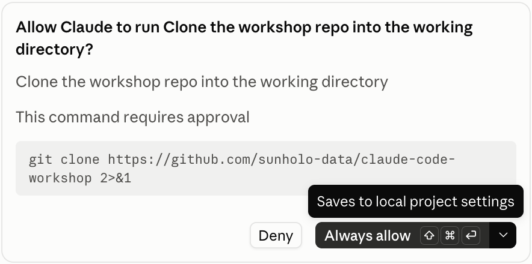

# Get the workshop onto your laptop

*In the workshop, the facilitator walks the room through this from the slides. This page is for doing it beforehand, or afterwards on your own.*

The workshop is a folder of files on GitHub. To use it, you need a copy on your laptop and a Code
tab session opened on that copy. You already have the tools: Claude can make the copy for you.
Do this before the day, after `install` and `git-installed`.

## Do

1. In the Code tab, open a session on your `claude-test` folder (the one from `install`). Keep the
   mode on **Manual**.
2. **Predict:** you ask Claude to copy the workshop from GitHub. Which command will it want to run,
   and will it ask you first?
3. Send:

   > Clone https://github.com/sunholo-data/claude-code-workshop into this folder, then tell me how to start the workshop.

4. Claude shows you the command (`git clone …`) and asks before running it. Read it, then allow it.

   

   The big button may say **Always allow**: that saves a rule, so this command never asks again in
   this folder. Look at the arrow beside it before choosing. Which you pick is your first trust
   decision of the day.

   This is the first of many approvals; reading them is the habit the whole day builds.
   Then it tells you the next step, from the README: a new session on the workshop folder.
   Asking for the one thing you want next, rather than "what's in it?", gets a short answer.
5. Start a **new session** (**+ New** at the top left). Choose **This computer**, **Select folder**, and pick
   the new `claude-code-workshop` folder *inside* `claude-test`.
6. Type **start the workshop**. The guide reads the course and offers you somewhere to start. The
   first time, it asks to create `progress.md`, your own record of what you've done. Allow it.

### If git isn't working yet

On the GitHub page, click the green **Code** button, then **Download ZIP**. Unzip it and select the
unzipped folder in step 5. Everything up to the Git lessons works the same way. Once git works,
redo step 3, and ask Claude to copy your `progress.md` across to the new folder.

## Proof

The guide answered **start the workshop** from a session opened on the workshop folder, and
`progress.md` exists in that folder.

## Misconceptions this exposes

- *"Claude is inside GitHub."* Claude works on files on your laptop. GitHub is where the shared
  copy lives; cloning brings a copy down.
- *"One session can see everything."* A session sees the folder you chose. That's why step 5 opens
  a new session on the workshop folder, rather than carrying on in `claude-test`.
