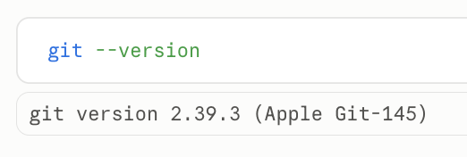

# Git and a GitHub account

*In the workshop, the facilitator walks the room through this from the slides. This page is for doing it beforehand, or afterwards on your own.*

Git keeps a history of a folder, so any change Claude makes can be seen and undone. GitHub is
where the team's shared work lives. The Code tab does **not** include git, so it is the one thing
you install yourself. Do this before the day.

## Do

1. **Predict:** is git already on your computer? Most Macs have it, or offer to fetch it; most
   Windows PCs don't.
2. Open a session in the Code tab (any folder, `claude-test` is fine). In the message box, type
   `!git --version` and send it. The `!` means *run this myself*: the command runs straight away,
   without Claude and without asking, and the result appears in the conversation.

   

3. If it prints a version number, you're done with this step. If not:
   - **Mac:** git comes with Apple's developer tools. Asking for git when they're missing makes
     macOS offer to install them in a pop-up: click **Install** and wait a few minutes. No pop-up?
     Send `!xcode-select --install`.
   - **Windows:** install **Git for Windows** from git-scm.com/downloads/win, accepting the
     defaults. Restart Claude Desktop afterwards so it finds git.
4. Send `!git --version` again.
5. If you don't have a GitHub account, make one at **github.com/signup**. Use the email you'll
   use for work, and turn on two-factor sign-in when it offers.
6. Send your GitHub username (not your password) to the facilitator.

You could also ask Claude to check for git and explain what it finds. The difference: with `!`
you run the command; without it, Claude decides what to run and asks you first.

## Proof

`git --version` prints a version, and the facilitator has your GitHub username.

## Misconceptions this exposes

- *"Git and GitHub are the same thing."* Git is the tool on your laptop and works with no account
  at all. GitHub is a website that stores copies of git repositories so people can share them.
- *"Commands need a terminal."* A `!` in the message box runs one for you, and Claude can see the
  result. Most of the day you will ask Claude to run commands and read them, not type them.
- *"`!` is fine for everything."* Its output lands in the conversation, which Claude reads. Signing
  in to anything stays out of it: that happens in the terminal pane or a browser.
