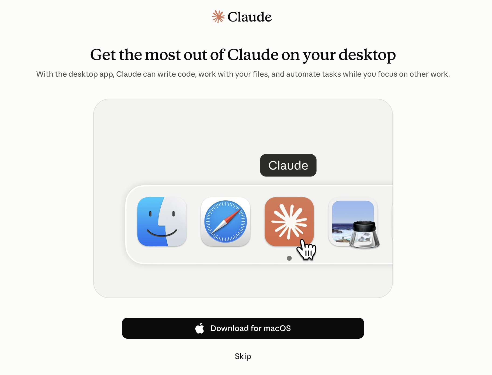
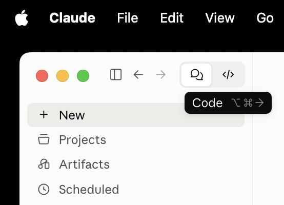
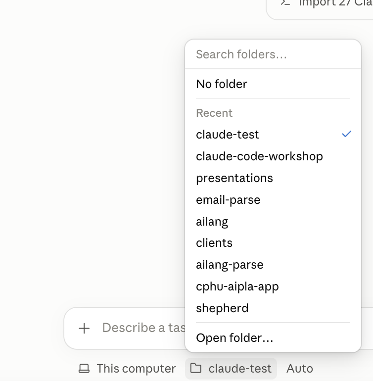
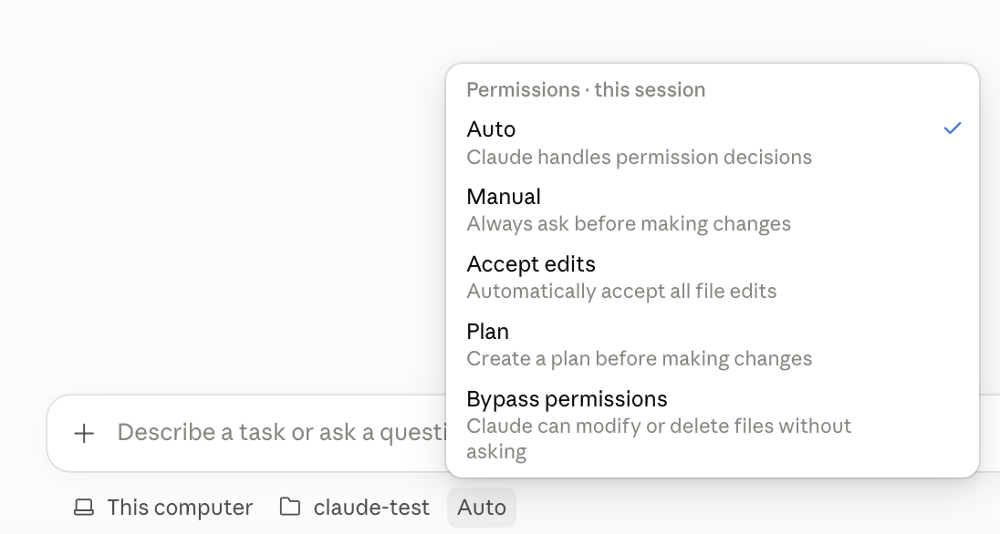

# Claude Desktop, Code tab

*In the workshop, the facilitator walks the room through this from the slides. This page is for doing it beforehand, or afterwards on your own.*

The Code tab is Claude with hands: it works inside a folder on your computer, reading and writing
the files there. The desktop app already includes Claude Code, so there is nothing else to install
(no Node.js, no command line). It needs a paid plan: Pro, Max, Team or Enterprise. Do this before
the day, and bring any error message with you.

## Do

**Where:** the Claude Desktop app on your own laptop, then a session on a new, empty folder
called `claude-test` in your Documents, in Manual.

1. Download Claude Desktop from **claude.com/download**, install it, and sign in.

   

   **You should see:** the Claude window, signed in to the account with your paid plan.
2. Click the **Code** button (**</>**) at the top left.

   

   **You should see:** a message box with a folder button under it. If it asks you to upgrade,
   your plan doesn't include the Code tab: tell the facilitator before the day.
3. In Finder or File Explorer, make an empty folder called `claude-test` in your Documents.
4. Click **+ New**. In the bar under the message box, choose **This computer**, then the folder
   button and **Open folder…**, and pick `claude-test`.

   

   **You should see:** the folder button now says `claude-test`.
5. In the same bar, the mode button says **Auto**: that's the default. Click it and choose
   **Manual**. Leave **Bypass permissions** alone.

   

   **You should see:** the button says **Manual**. No Auto in the list? Your plan or organisation
   hasn't turned it on; choose Manual all the same. A new session can start in **Auto** again, so
   check this button every time you click **+ New** today.

   Next to it, the model button: choose **Haiku** for the exercises. It's fast and uses the least
   of your plan's allowance; Opus and Fable are slower and can use a day's allowance in a morning
   of exercises. Keep them for hard work later.
6. **Predict:** you send the prompt below. Will the file just appear? Will Claude ask you first?
   Where on your computer will it go?
7. Send it:

   > Create a file called hello.txt that says hello.

   **You should see:** Claude shows the new file and asks before saving it. Accept. Then open
   `claude-test` in Finder or File Explorer: `hello.txt` is there. Not there? Check the folder
   button says `claude-test`, not another folder.

## Proof

`hello.txt` exists in `claude-test`, and you opened it yourself.

## Misconceptions this exposes

- *"It's the same as the chat tab."* The Chat tab has no access to your files; the Code tab works
  in the folder you chose, and only there unless you allow more.
- *"I need to install developer tools first."* Not for this. Git comes next, and only because the
  later lessons use it.
