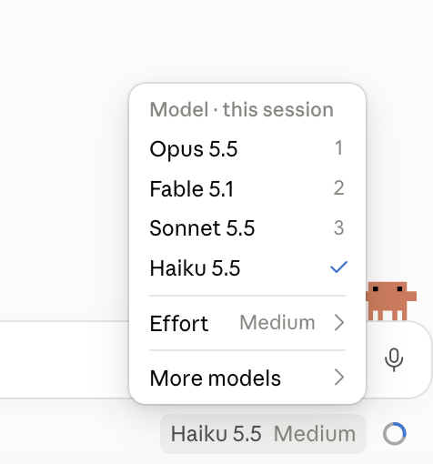

# Choosing a model

The menu at the bottom right, under the message box, chooses the model, and you can change it mid-session. Larger
models are usually better at hard, many-step work; smaller ones are faster and use less of your
plan's allowance. For a lot of everyday tasks you can't tell the difference, and that's worth
finding out for yourself.

## Do

**Where:** a session on the `claude-code-workshop` folder, in Manual.

1. Open the model menu at the bottom right, under the message box, and note which models you can
   choose and which one is selected.

   

2. **Predict:** you'll ask two models the same thing. Which will be faster? Which answer will you
   prefer, and will you be able to tell them apart?
3. On the selected model, send:

   > Read samples/daily-sessions.csv and give me three bullet points on what happened in September.

   **You should see:** three bullets, with no approval prompt: reading a file inside the folder
   doesn't ask.
4. **+ New**, open `claude-code-workshop` again, choose a different model in the menu, and send
   exactly the same prompt.
5. Compare: speed, accuracy (check one number against the CSV yourself), and whether either
   noticed the signups dropping to zero.

## Proof

The same task on two models, and one sentence on the difference you saw.

## Misconceptions this exposes

- *"Always use the biggest model."* It costs more of your allowance and is slower; for a small,
  well-described task it often adds nothing.
- *"The model is the only thing that matters."* A clear request and the right files usually change
  the answer more than the model does.
