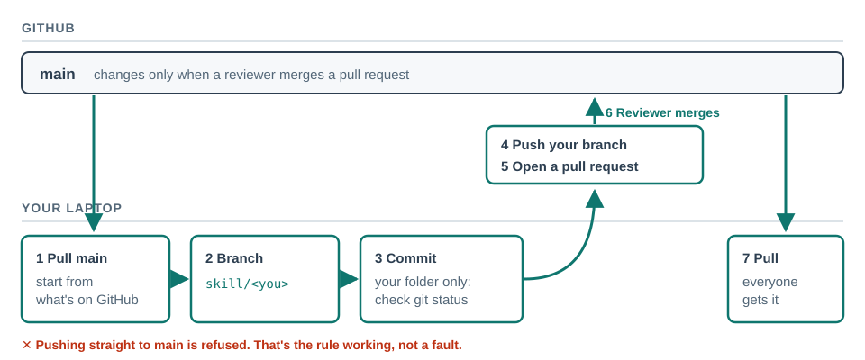

# Your skill, in everyone's copy

A pull request asks for your branch to be merged into the main version. Once it is merged,
everyone who pulls gets your change, and you get theirs. Here everyone in the room adds one small
skill to this workshop repository. The facilitator merges them all, then everyone pulls and finds
the whole room's work in their own copy.

## Do

**Where:** a session on the `claude-code-workshop` folder, in Manual, after
[clone-branch](clone-branch.md) worked. If it didn't, do its step 1 (the GitHub check) first.

1. Start from what's on GitHub now:

   > Switch to main and pull. Then show me git status.

   **You should see:** `Already up to date` or a list of new files, then `nothing to commit` or only
   untracked files. If it says your main is *ahead of* `origin/main`, ask: *"Make my local main
   match origin/main exactly"* and approve the `git reset` it asks for.
2. Make your branch:

   > Make a branch called skill/<your-github-username> and switch to it.

3. Write one small skill in its own folder. Pick one idea, or bring your own:
   *explain-diff* (explain what changed since my last commit, in plain English), *where-was-i*
   (summarise my progress.md in three lines), *check-before-push* (list what's about to be
   pushed, and anything that looks private).

   > Write a skill in .claude/skills/<your-github-username>-<skill-name>/SKILL.md that <what it does>. Set its name to <your-github-username>-<skill-name>, the same as the folder. Write the description as the words a colleague would type when they want it. Change no other file.

   **You should see:** one new `SKILL.md`, and a request to save it (approve). The `name:` line is
   what everyone will type after `/`; with your username in it, it can't clash with a colleague's.
4. Test it the way a colleague will meet it: click **+ New** for a fresh session on the same
   folder, type `/` and find your skill, then run it. Back in this session:

   > Commit only the .claude/skills/<your-github-username>-<skill-name> folder.

   **You should see:** a commit with `1 file changed`. More? Say *"undo that commit, then commit only
   my skill folder"*.
5. **Predict:** after you push and open a pull request, will your skill appear in your
   neighbour's Code tab? When will it?
6. Push and open the pull request:

   > Push this branch, then open a pull request into main with gh. Title: my skill's name. Body: one line on what it does and one request to test it with.

   **You should see:** two approval prompts (push, then `gh pr create`), then a pull request link.
   No `gh`? Open github.com/sunholo-data/claude-code-workshop and click the yellow **Compare &
   pull request** banner.
7. Wait for the facilitator to merge. You can't merge it yourself: `main` only changes through a
   reviewed pull request. Open your pull request's link while you wait.
8. When the facilitator says everything is merged:

   > Switch to main and pull.

   Then **+ New** for a fresh session, type `/`, and find your skill and the others. Run one a
   colleague wrote.

## Proof

After the merge and a pull, your skill and a colleague's both appear when you type `/`, and you
ran theirs.

## Why one folder each

Everyone changes different files, so every pull request merges cleanly, in any order. If two
people had edited the same line of the same file, the second merge would stop with a conflict.
That's worth seeing once, but not with fifteen people at once.

## Misconceptions this exposes

- *"Merged means everyone has it."* Merged means it's on GitHub's `main`. Nobody's laptop changes
  until they pull.
- *"I pushed, so it's in main."* You pushed a branch. Someone else decides whether it joins `main`.
- *"I can't break anything by opening a PR."* True, and that's the point: the review is the gate.
