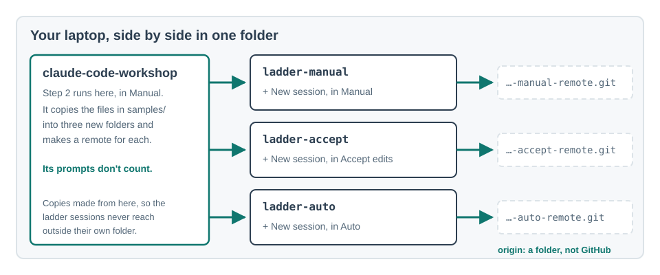

# Trust is earned per action

You don't trust Claude or distrust it as a whole. You trust it with particular actions: saving a
file, yes; committing, yes; publishing to everyone, not without a look. Each kind of action sits
on its own rung, and it climbs only on evidence from the rung below. This is the delegation ladder
from Sunholo's Decision Budget, and Claude Code's permission modes and rules map onto it directly.

| Rung | What it means | In Claude Code |
|---|---|---|
| ■□□□□ **held** | A person decides, every time, and it stays that way | A **deny** rule: Claude may never do it, in any mode |
| ■■□□□ **instrumented** | Nothing is decided yet, but you can see what would be | **Plan** mode: Claude shows what it would do and changes nothing |
| ■■■□□ **shadow** | It decides in private; nothing counts yet | Work on a **branch** or a copy: nothing counts until you merge it |
| ■■■■□ **proposing** | It acts; a person approves before it counts | **Manual** mode, and **ask** rules: you approve each action |
| ■■■■■ **automated** | Unattended inside stated limits; outside them it stops and asks | **Accept edits** or **Auto**, plus **allow** rules. Your ask and deny rules are the limits, and they still hold in Auto |

## Do

**Where:** first a session on the `claude-code-workshop` folder, in Manual, to build three copies.
Then one **+ New** session on each copy, which you open yourself: `ladder-manual` in Manual,
`ladder-accept` in Accept edits, `ladder-auto` in Auto. The copies have no rules of their own
yet, which is the point.

1. Check git knows who you are. Send:

   ```
   !git config user.email
   ```

   **You should see:** your email. Nothing? Git won't ask you later: a commit either stops with
   *"Author identity unknown"* or, on a Mac, goes through under a made-up name from your laptop's
   name. Set it now:

   > Set my git name to <your name> and email to <the email on your GitHub account>, for every repository.

2. Build the three copies, each with its own first commit and its own place to push to. In the
   workshop session:

   

   > Next to this workshop folder, not inside it, make three folders: ladder-manual, ladder-accept and ladder-auto. Copy the files in samples/ into each one, not the samples folder itself. Make each a git repository and commit those files. Then, also next to this folder, make three empty repositories with git init --bare: ladder-manual-remote.git, ladder-accept-remote.git and ladder-auto-remote.git. Add each one to its folder as the remote called origin.

   **You should see:** several approval prompts (approve them: this session's prompts don't
   count), then three folders and three `.git` repositories next to `claude-code-workshop`.
   Check with `!ls ..`. Nothing goes to GitHub: each copy pushes only to a folder on your laptop.
3. **Predict:** you'll send the task below once in each copy. How many times will Claude stop and
   ask in **Manual**? In **Accept edits**? In **Auto**? Write your three numbers down.

   > Sort the files in this folder into folders by type, write a short README listing them, and commit.
4. **+ New**, open `ladder-manual`, set the mode to **Manual**, and send the task from step 3. Count every
   approval prompt.

   **You should see:** a prompt for most steps: making folders, moving files, writing the README,
   committing. If it asks whether you trust the folder, say yes; that one doesn't count.
5. **+ New**, open `ladder-accept`, set **Accept edits**, send the task, count.
6. **+ New**, open `ladder-auto`, set **Auto**, send the task, count.

   No **Auto** in the mode selector? Your plan or organisation hasn't turned it on. Do 4 and 5,
   and skip step 7.
7. Still in the `ladder-auto` session, guess first: will it ask, try, or refuse? Then:

   > Now push this to origin.

   **You should see:** either a push to `ladder-auto-remote.git` or a prompt. With no rules,
   whether Auto stops is a background check's call, not yours. In block 3 you add an ask rule
   for `git push`, and from then on it stops for you even in Auto. That is a ceiling: publishing
   stays at proposing, permanently.
8. Go back to the `ladder-manual` session and ask for one more small change:

   > Add one line to the README saying when these files were sorted, and commit it.

   When it asks to run `git commit`, choose **Always allow**. Then ask for another line and a
   commit. **You should see:** no prompt for the commit this time. You've promoted one action from
   proposing to automated, on the evidence that you approved it each time without changing
   anything. The rule is saved in this folder only.

## Proof

Your three predicted and three actual prompt counts, and what Auto did when you asked it to push.

## Misconceptions this exposes

- *"Auto mode means I've stopped checking."* You've stopped checking the routine. The actions
  you've marked as ask still stop for you, every time.
- *"Trust is a setting for the whole session."* It's per action. The same session can commit
  freely and still ask before every push.
- *"Promotion only goes up."* If an allowed action lets a mistake through, move it back to ask.
  Down is a normal move.
